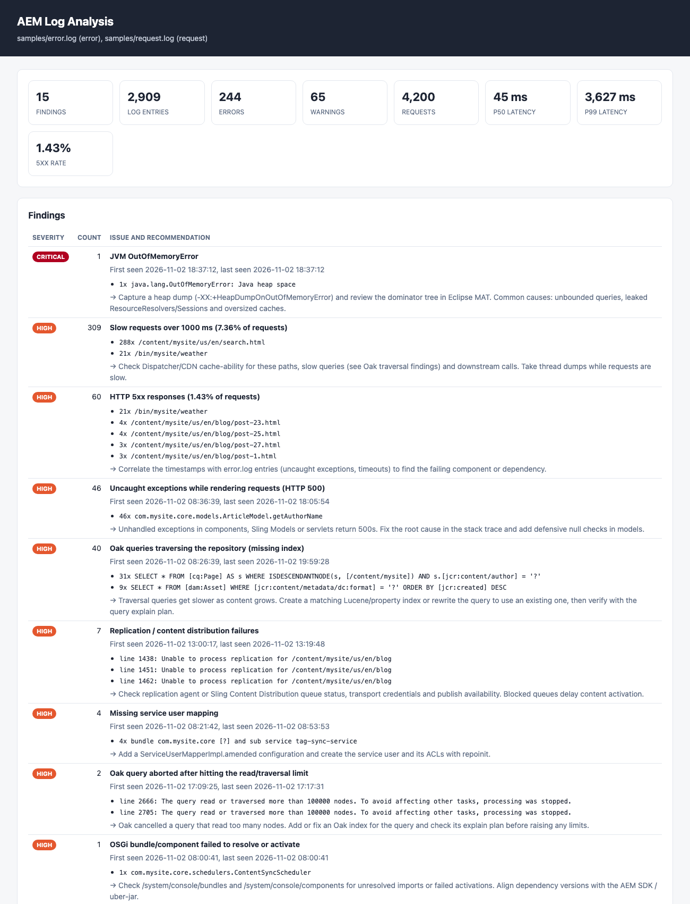

# AEM Log Analyzer

[](https://github.com/navi00498/aem-log-analyzer/actions/workflows/ci.yml)


A command-line tool that turns thousands of lines of **Adobe Experience Manager (AEM)** `error.log` and
`request.log` into a short, prioritized list of problems, each with a recommended next step.

I built this from my experience doing AEM escalation work. The first 30 minutes of most incidents go
to the same steps: grep the error log, group the stack traces, look for traversal warnings, line up slow
requests with errors, and check for OOMs. This tool does that triage in seconds.



## Features

- **Parses AEM 6.x, AMS and AEM as a Cloud Service logs.** It handles AEMaaCS pod names, multi-line
  stack traces, thread names with nested brackets, and `.gz` rotated files.
- **Groups similar errors.** It normalizes UUIDs, JCR paths, numbers and literals, so 160 copies of the
  same error show up as one row with first-seen and last-seen times and the root-cause exception.
- **Detects known AEM issues** and suggests how to fix each one:

  | Rule | What it catches |
  |---|---|
  | `jvm-oom` | `OutOfMemoryError`, GC overhead |
  | `oak-traversal` | Queries that traverse the repository. Each query is extracted with its literals removed, so you know which index to create. |
  | `oak-query-limit` | Queries aborted after reading 100k+ nodes |
  | `oak-index-corrupt` / `oak-async-index` | Lucene index corruption, failing async indexing |
  | `service-user-mapping` | `Cannot derive user name for bundle …` |
  | `unclosed-resolver` | Leaked `ResourceResolver`s / JCR sessions, pointing to *your* class that opened them |
  | `replication` | Replication / Sling Content Distribution failures |
  | `osgi-component` | Bundles that fail to resolve, components that fail to activate |
  | `sling-uncaught` | Uncaught exceptions during rendering (HTTP 500s), pointing to the failing project class |
  | `oak-commit-conflict` | `OakState0001` / `CommitFailedException` |
  | `workflow`, `auth-sso` | Workflow failures, login/SAML errors |
  | `downstream-timeout` | Socket timeouts and refused connections, grouped by host |
  | `noisy-logger` | One error logged 100+ times, which drowns out real problems |

- **Request analysis.** Pairs each `->` request line with its `<-` response line and reports p50, p90,
  p95 and p99 latency, the slowest URLs and paths (with IDs normalized), the 5xx rate, and requests that
  never finished, which can point to hung threads.
- **Three output formats:** colour-free text for terminals and tickets, JSON for automation, and a
  single self-contained **HTML** report (no JavaScript, safe to attach to a case).
- **CI/CD gate.** `--fail-on high` exits with status 1 when serious issues are found, so you can run it
  against logs from a test environment after a deployment.
- **No dependencies.** Only the Python standard library.

## Quick start

```bash
pip install git+https://github.com/navi00498/aem-log-analyzer.git

aem-log-analyzer error.log request.log                 # text report in the terminal
aem-log-analyzer error.log* request.log -o report.html # HTML report (format inferred from extension)
aem-log-analyzer error.log --format json > report.json
```

To try it on the bundled synthetic logs:

```bash
git clone https://github.com/navi00498/aem-log-analyzer.git && cd aem-log-analyzer
python -m pip install .
aem-log-analyzer samples/error.log samples/request.log -o report.html && open report.html
```

### Example output

```text
error.log   2,909 entries (2026-11-02 08:00:29 → 2026-11-02 19:59:56)
            INFO 2,600, ERROR 244, WARN 65

request.log 4,200 requests (2026-11-02 08:00:28+00:00 → 2026-11-02 19:59:35+00:00)
            p50 45 ms | p90 238 ms | p99 3,627 ms | max 10,034 ms
            5xx 60 (1.43%) | slow (≥1000 ms) 309

FINDINGS (15)
------------------------------------------------------------
[CRITICAL] JVM OutOfMemoryError (1x)
           • 1x java.lang.OutOfMemoryError: Java heap space
           → Capture a heap dump (-XX:+HeapDumpOnOutOfMemoryError) and review the dominator tree in Eclipse MAT...

[HIGH    ] Uncaught exceptions while rendering requests (HTTP 500) (46x)
           • 46x com.mysite.core.models.ArticleModel.getAuthorName
           → Unhandled exceptions in components, Sling Models or servlets return 500s...

[HIGH    ] Oak queries traversing the repository (missing index) (40x)
           • 31x SELECT * FROM [cq:Page] AS s WHERE ISDESCENDANTNODE(s, [/content/mysite]) AND s.[jcr:content/author] = '?'
           • 9x SELECT * FROM [dam:Asset] WHERE [jcr:content/metadata/dc:format] = '?' ORDER BY [jcr:created] DESC
           → Create a matching Lucene/property index or rewrite the query to use an existing one...
```

## Options

```text
aem-log-analyzer FILE [FILE ...] [-f {text,json,html}] [-o OUTPUT] [-t {auto,error,request}]
                 [--slow-ms 1000] [--top 10] [--fail-on {low,medium,high,critical}]
```

| Option | Default | Description |
|---|---|---|
| `-f, --format` | from `-o` extension, else `text` | Output format |
| `-o, --output` | stdout | Write the report to a file |
| `-t, --type` | `auto` | Force the log type instead of detecting it per file |
| `--slow-ms` | `1000` | Threshold for counting a request as slow |
| `--top` | `10` | Rows per table |
| `--fail-on` | off | Exit with status 1 if any finding is at or above this severity |

Exit codes: `0` success, `1` the `--fail-on` threshold was reached, `2` usage error or no recognizable logs.

## Using it in a pipeline

```yaml
# GitHub Actions: fail the job if logs from a test environment contain high/critical issues
- run: pip install git+https://github.com/navi00498/aem-log-analyzer.git
- run: aem-log-analyzer logs/error.log logs/request.log -o report.html --fail-on high
- uses: actions/upload-artifact@v4
  if: always()
  with: { name: aem-log-report, path: report.html }
```

On AEM as a Cloud Service, you can download logs from Cloud Manager or tail them with the
`aio cloudmanager:tail-log` command from the Adobe I/O CLI.

## How it works

```text
error.log ─► parse_error_log ─► LogEntry (+stack) ─► rules.match_rule ─► ErrorLogStats ─┐
                                                                                        ├─► findings ─► text / json / html
request.log ─► parse_request_log ─► Request (paired -> / <-) ─────────► RequestLogStats ─┘
```

- `parsers.py`: streaming parsers, so files of any size are read line by line.
- `rules.py`: ordered rule table (regex, severity, remediation hint, optional detail extractor).
  Adding a rule is a single entry.
- `analyzer.py`: grouping, normalization, percentiles and finding generation.
- `report.py`: renderers.

## Development

```bash
python -m pip install -e . ruff
python -m unittest discover -s tests -v
ruff check .
python scripts/generate_samples.py   # regenerate the deterministic sample logs
```

## Roadmap

- [ ] Dispatcher log support (cache hit ratio, blocked filter rules)
- [ ] CDN log support (Fastly/Akamai cache status)
- [ ] Correlate 5xx responses in request.log with the error.log entries that caused them
- [ ] Thread dump summarizer (blocked/hot threads across a series of dumps)

## Disclaimer

This is a personal project. It is not affiliated with or endorsed by Adobe. It was built from public
Apache Sling, Jackrabbit Oak and AEM documentation. The sample logs in `samples/` are synthetic (generated by
`scripts/generate_samples.py`) and contain no real customer data.

## License

[MIT](LICENSE)
